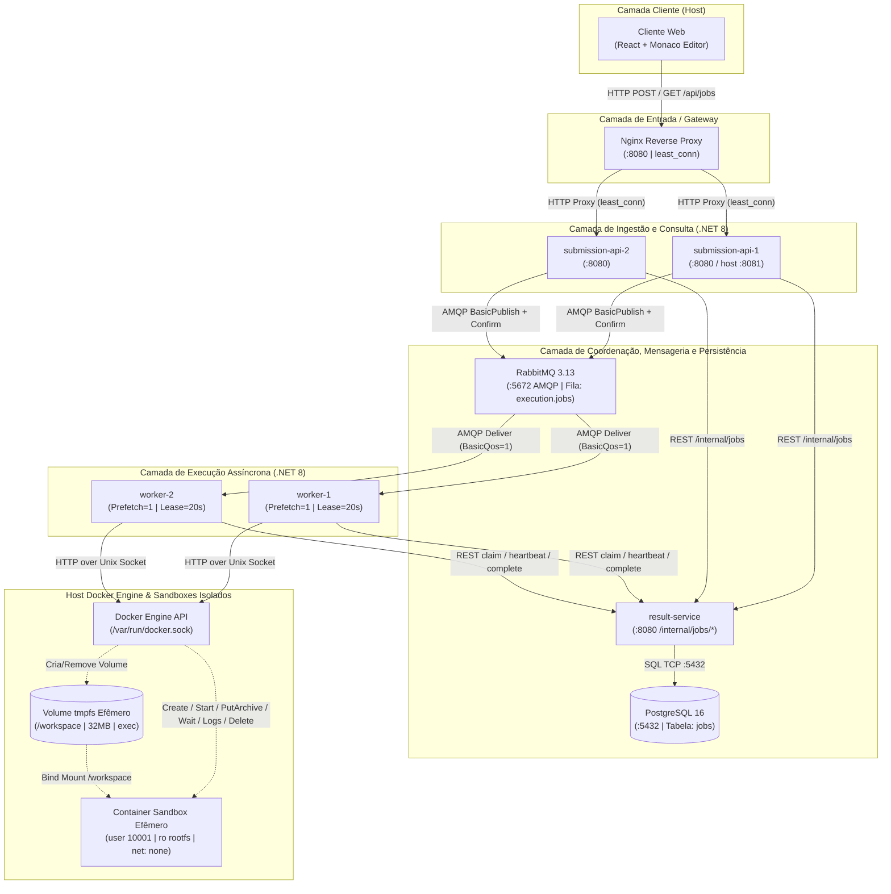

# Avaliação e Mapeamento Técnico da Infraestrutura `DockerCode`

Este documento registra a análise técnica minuciosa da pasta `../DockerCode`, servindo como **fonte da verdade** para que o simulador `DockerTracer` represente fielmente todos os serviços, protocolos, estados, cabeçalhos e mecanismos de tolerância a falhas implementados.

---

## 1. Inventário de Nós (Containers e Recursos)

No arquivo `DockerCode/docker-compose.yml`, a infraestrutura é composta por **8 containers de longa duração**, **1 container de preparação (build-time)** e **containers/volumes efêmeros sob demanda**:

| ID Lógico no Tracer | Nome no Compose / Docker | Imagem / Base | Portas Expostas / Internas | Acesso a `/var/run/docker.sock` | Papel Principal |
| :--- | :--- | :--- | :--- | :--- | :--- |
| `client-browser` | *(Host / Navegador)* | SPA React 19 + Monaco | Acessa `:8080` (Nginx) ou `:5173` (Vite) | Não | Submete código (`POST /api/jobs`) e faz polling a cada `750ms` (`GET /api/jobs/{id}`) |
| `nginx-gateway` | `frontend` | `nginx` + build estático Vite | Host `8080` $\rightarrow$ Container `80` | Não | Serve os assets estáticos e faz proxy reverso de `/api/` com algoritmo `least_conn` |
| `submission-api-1` | `submission-api-1` | .NET 8 ASP.NET Core | Host `8081` $\rightarrow$ `8080` (interna `8080`) | **Não** | Valida payload, cria Job no Result Service, publica no RabbitMQ e atende consultas |
| `submission-api-2` | `submission-api-2` | .NET 8 ASP.NET Core | Interna `8080` (acessível via Nginx) | **Não** | Segunda réplica da API de submissão para alta disponibilidade e distribuição de carga |
| `result-service` | `result-service` | .NET 8 ASP.NET Core | Interna `8080` (endpoints `/internal/*`) | **Não** | Único serviço com acesso ao PostgreSQL; gerencia estados, *claims*, *leases* e *heartbeats* |
| `postgres-db` | `postgres` | `postgres:16-alpine` | Interna `5432` (volume `postgres-data`) | **Não** | Persistência relacional da tabela `jobs` e índice `ix_jobs_status_lease` |
| `rabbitmq-broker` | `rabbitmq` | `rabbitmq:3.13-management-alpine` | Interna `5672` (AMQP), Host `15672` (UI) | **Não** | Broker de mensageria responsável pela fila durável `execution.jobs` |
| `worker-1` | `worker-1` | .NET 8 Worker + Web (`Worker__Id=worker-1`) | Interna `8080` (`/health`) | **Sim** | Consome fila `execution.jobs`, faz *claim* no Result Service e controla o Docker Engine |
| `worker-2` | `worker-2` | .NET 8 Worker + Web (`Worker__Id=worker-2`) | Interna `8080` (`/health`) | **Sim** | Segunda réplica concorrente de execução para paralelismo real de Jobs |
| `sandbox-builder` | `sandbox-builder` | `docker:27-cli` | Nenhuma (`restart: "no"`) | **Sim** | Constrói as 4 imagens `dockercode-sandbox-<lang>:latest` na inicialização e encerra (`exit 0`) |
| `sandbox-ephemeral` | `dockercode-<jobId>-<6hex>` | Python 3.12 / Node 22 / Java 21 / GCC 14 | **Sem rede (`network: none`)** | **Não** | Container efêmero criado por tentativa de execução e destruído ao final (`force=true&v=true`) |
| `tmpfs-workspace` | Volume `dockercode-<jobId>-<6hex>` | Driver `local` (`type=tmpfs`) | Montado em `/workspace` (`32 MiB`, `exec`) | N/A | Volume em memória RAM criado antes do container para receber o arquivo `.tar` de código e `stdin` |

---

## 2. Topologia de Rede e Enlaces de Comunicação



---

## 3. Fluxo Detalhado de Protocolos Passo a Passo (Ciclo de Vida de um Job)

Abaixo está a sequência exata de pacotes/operações que acontecem no código do `DockerCode` quando o usuário clica em **Run**:

### Fase A — Submissão e Persistência Inicial (Ingestão Síncrona)
1. **Cliente $\rightarrow$ Nginx (`HTTP POST /api/jobs`):**
   - Body JSON: `{ "language": "python|javascript|java|cpp", "sourceCode": "...", "stdin": "..." }`.
2. **Nginx $\rightarrow$ Submission API (`1` ou `2`):**
   - Algoritmo `least_conn` escolhe a réplica com menos conexões ativas.
   - Repassa headers `X-Real-IP`, `X-Forwarded-For` e `X-Correlation-ID`.
3. **Validação na Submission API (`SubmissionApi/Program.cs`):**
   - Verifica se `language` pertence a `{python, javascript, java, cpp}`.
   - Verifica se `sourceCode` não é vazio e tem tamanho $\le 64\text{ KiB}$ em UTF-8.
   - Verifica se `stdin` tem tamanho $\le 32\text{ KiB}$ em UTF-8.
   - Gera um `CorrelationId` (`Guid.NewGuid().ToString("N")`) caso o header `X-Correlation-ID` não tenha vindo na requisição.
4. **Submission API $\rightarrow$ Result Service (`POST /internal/jobs`):**
   - Envia `{ language, sourceCode, stdin, correlationId }`.
5. **Result Service $\rightarrow$ PostgreSQL (`INSERT INTO jobs`):**
   - Insere registro inicial com `status = 'QUEUED'`, `created_at = UtcNow`, `attempt_count = 0`.
   - Retorna `{ jobId, status: "QUEUED" }` para a Submission API.
6. **Submission API $\rightarrow$ RabbitMQ (`AMQP BasicPublish`):**
   - Declara fila `execution.jobs` (`durable: true`).
   - Publica mensagem JSON `{ "JobId": "...", "CorrelationId": "..." }` com `Persistent = true` e `MessageId = JobId`.
   - Aguarda confirmação do broker via `WaitForConfirmsOrDie(5s)` (*Publisher Confirms*).
   - **Caminho de Falha de Broker:** Se o RabbitMQ falhar, a Submission API chama `POST /internal/jobs/{id}/mark-failed` no Result Service com `failureReason = "BROKER_UNAVAILABLE"` e retorna `HTTP 503 Service Unavailable`.
7. **Submission API $\rightarrow$ Nginx $\rightarrow$ Cliente (`HTTP 202 Accepted`):**
   - Header `Location: /api/jobs/{jobId}` e `X-Correlation-ID`.
   - Body: `{ "jobId": "...", "status": "QUEUED" }`.

### Fase B — Consumo Assíncrono, Claim e Lease (Coordenação Distribuída)
8. **RabbitMQ $\rightarrow$ Execution Worker (`1` ou `2`) (`AMQP BasicDeliver`):**
   - O canal usa `BasicQos(prefetchSize: 0, prefetchCount: 1, global: false)`, garantindo que cada Worker processe 1 Job por vez e que mensagens excedentes aguardem no broker.
   - `autoAck: false` (confirmação manual somente após persistência final).
9. **Execution Worker $\rightarrow$ Result Service (`POST /internal/jobs/{id}/claim`):**
   - Envia `{ workerId: "worker-1", leaseSeconds: 20 }`.
10. **Result Service $\rightarrow$ PostgreSQL (`UPDATE jobs ... RETURNING`):**
    - Executa query atômica:
      ```sql
      UPDATE jobs
      SET status = 'RUNNING',
          worker_id = @workerId,
          lease_token = @leaseToken,
          lease_until = @leaseUntil,
          started_at = COALESCE(started_at, CURRENT_TIMESTAMP),
          attempt_count = attempt_count + 1
      WHERE id = @id
        AND attempt_count < 3
        AND (status = 'QUEUED' OR (status = 'RUNNING' AND lease_until < CURRENT_TIMESTAMP))
      RETURNING ...;
      ```
    - Se `attempt_count >= 3` e o lease expirou, marca o Job como `FAILED` (`failure_reason = 'INFRA_ERROR'`).
    - Retorna `ClaimResponse` contendo `Acquired = true`, `LeaseToken`, `Language`, `SourceCode`, `Stdin`.
11. **Início do Loop de Heartbeat em Background (`JobConsumer.cs`):**
    - A cada **5 segundos**, o Worker envia `POST /internal/jobs/{id}/heartbeat` com `{ workerId, leaseToken, leaseSeconds: 20 }` para estender `lease_until` no PostgreSQL enquanto o container estiver rodando.

### Fase C — Orquestração do Sandbox Isolado (Docker Engine via Unix Socket)
12. **Worker $\rightarrow$ Docker Engine (`POST /volumes/create`):**
    - Cria volume efêmero `dockercode-<jobId>-<6hex>` com driver `local` e opções `type=tmpfs`, `size=32m,exec,nosuid,nodev,uid=10001,gid=10001,mode=0700`.
    - *Motivo Arquitetural Importante:* O Docker Engine recusa `PUT /containers/{id}/archive` quando `ReadonlyRootfs = true` se o destino for um `HostConfig.Tmpfs` interno, mas permite quando o destino é um volume montado em `/workspace`. Além disso, a flag `exec` permite executar o binário `./main` compilado pelo `g++`.
13. **Worker $\rightarrow$ Docker Engine (`POST /containers/create`):**
    - Imagem conforme a linguagem (`dockercode-sandbox-python:latest`, `javascript`, `java` ou `cpp`).
    - Comando inicial com barreira de sincronização:
      `while [ ! -f /workspace/.ready ]; do sleep 0.05; done; <comando_da_linguagem>`
    - Restrições de segurança (`HostConfig`):
      - `User = "10001:10001"`
      - `NetworkMode = "none"` (isolamento total de rede)
      - `ReadonlyRootfs = true`
      - `Memory = 256 MiB` (`MemorySwap = 256 MiB`, sem swap extra)
      - `NanoCpus = 1_000_000_000` (1.0 vCPU)
      - `PidsLimit = 64` (proteção contra *fork bomb*)
      - `CapDrop = ["ALL"]` e `SecurityOpt = ["no-new-privileges"]`
      - `Binds = ["<volume>:/workspace"]` e `Tmpfs = { "/tmp": "rw,nosuid,nodev,size=32m,mode=1777" }`
14. **Worker $\rightarrow$ Docker Engine (`POST /containers/{id}/start`):**
    - Inicia o container (que fica aguardando o arquivo `.ready` aparecer em `/workspace`).
15. **Worker $\rightarrow$ Docker Engine (`PUT /containers/{id}/archive?path=/workspace`):**
    - Constrói em memória um arquivo `.tar` (`TarArchiveHelper.cs`) contendo:
      - Arquivo fonte (`main.py`, `main.js`, `Main.java` ou `main.cpp`)
      - `stdin.txt`
      - `.ready` (0 bytes — libera a barreira do `while` dentro do container!)
16. **Worker $\rightarrow$ Docker Engine (`POST /containers/{id}/wait?condition=not-running`):**
    - Aguarda término com `CancellationTokenSource` configurado para `10 segundos` (`Sandbox:TimeoutSeconds`).
    - **Caso ocorra Timeout:** O Worker dispara `POST /containers/{id}/kill` (`SIGKILL`) e classifica o resultado como ` status = "TIMEOUT", failureReason = "TIMEOUT"`.
17. **Worker $\rightarrow$ Docker Engine (`GET /containers/{id}/logs` & `GET /containers/{id}/json`):**
    - Faz o *demux* dos frames binários de 8 bytes do stream do Docker (`streamType 1 = stdout`, `streamType 2 = stderr`).
    - Trunca `stdout` e `stderr` em `64 KiB` (`[saída truncada pelo limite do sandbox]`).
    - Inspeciona `State.OOMKilled` e `State.ExitCode` no JSON do container.
18. **Classificação do Resultado no Worker:**
    - `timedOut == true` $\rightarrow$ `TIMEOUT` (`failureReason = "TIMEOUT"`)
    - `OOMKilled == true` ou `exitCode == 137` ou `stderr` contém `MemoryError` / `OutOfMemoryError` / `std::bad_alloc` $\rightarrow$ `FAILED` (`failureReason = "MEMORY_LIMIT"`)
    - `exitCode == 0` $\rightarrow$ `SUCCEEDED` (`failureReason = null`)
    - `stderr` contém marcador `__DOCKERCODE_COMPILE_ERROR__` (emitido quando `javac` ou `g++` falha) $\rightarrow$ `FAILED` (`failureReason = "COMPILE_ERROR"`, removendo o marcador da mensagem final)
    - Qualquer outro `exitCode != 0` $\rightarrow$ `FAILED` (`failureReason = "RUNTIME_ERROR"`)
19. **Limpeza Garantida (`finally` no Worker):**
    - `DELETE /containers/{id}?force=true&v=true`
    - `DELETE /volumes/{volumeName}?force=true`

### Fase D — Conclusão, Confirmação AMQP e Polling do Cliente
20. **Worker $\rightarrow$ Result Service (`POST /internal/jobs/{id}/complete`):**
    - Envia `{ workerId, leaseToken, status, stdout, stderr, exitCode, failureReason }`.
    - O Result Service só aceita o `UPDATE` no PostgreSQL se `status = 'RUNNING' AND worker_id = @workerId AND lease_token = @leaseToken` (proteção contra *split-brain* / *zombie worker*).
21. **Worker $\rightarrow$ RabbitMQ (`AMQP BasicAck`):**
    - Confirma e remove definitivamente a mensagem da fila `execution.jobs` e encerra a task de *heartbeat*.
22. **Cliente $\rightarrow$ Nginx $\rightarrow$ Submission API $\rightarrow$ Result Service (`GET /api/jobs/{id}`):**
    - O polling de `750ms` do React detecta o estado terminal (`SUCCEEDED`, `FAILED` ou `TIMEOUT`) e renderiza `stdout`, `stderr`, `exitCode` e `failureReason` no painel Console.

---

## 4. Resumo das Métricas e Tempos Observáveis no Sistema

O script `DockerCode/scripts/load-test.mjs` decompõe a execução de cada Job em 4 métricas temporais extraídas dos timestamps reais do banco (`createdAt`, `startedAt`, `finishedAt`):

1. **Latência de Ingestão HTTP (`ingestMs`):** Tempo do `POST /api/jobs` (Nginx $\rightarrow$ Submission API $\rightarrow$ Result Service SQL `INSERT` $\rightarrow$ RabbitMQ `Publish+Confirm` $\rightarrow$ `202 Accepted`).
2. **Tempo de Fila (`queueMs = startedAt - createdAt`):** Tempo em que o Job permaneceu `QUEUED` na fila `execution.jobs` do RabbitMQ até um Worker adquirir o *claim*.
3. **Tempo de Sandbox (`execMs = finishedAt - startedAt`):** Tempo total do Worker criando volume, subindo container, compilando/executando, coletando logs e persistindo resultado.
4. **Turnaround Total (`totalServerMs = finishedAt - createdAt`):** Tempo total de ponta a ponta no servidor.

Essas quatro grandezas serão exibidas em tempo real nos painéis de telemetria do **DockerTracer**.
