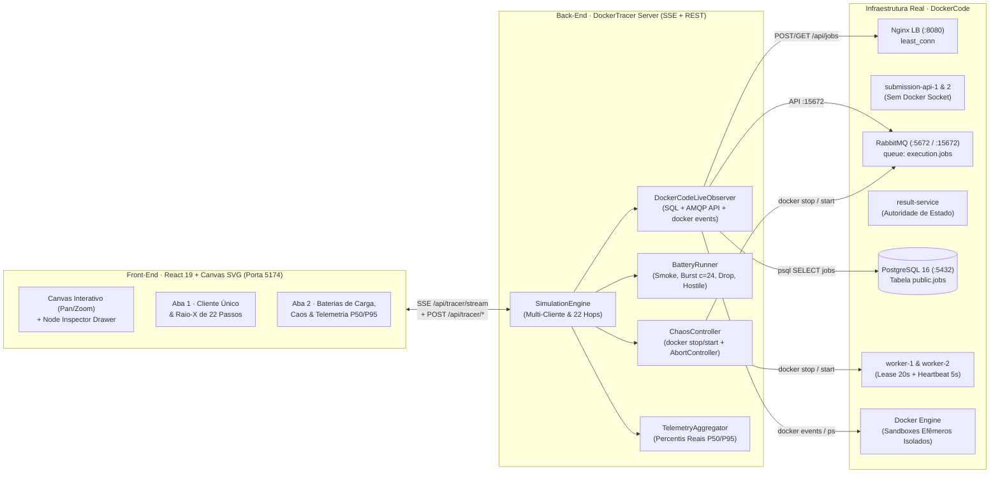

# DockerTracer — Distributed Sandbox Network Simulator & Live Control Plane

O **DockerTracer** é um painel interativo de observabilidade em tempo real, inspeção de protocolo (*Packet Tracer*) e injeção de falhas (*Chaos Engineering*) construído para operar **sincronamente sobre a infraestrutura real do `DockerCode`**.

Diferente de um mock estático, cada ação disparada no **DockerTracer** executa chamadas HTTP reais contra o **Nginx Load Balancer (`:8080`)**, publica mensagens reais no **RabbitMQ (`execution.jobs`)**, grava e consulta linhas reais na tabela `public.jobs` do **PostgreSQL 16 (`:5432`)**, cria containers e volumes `tmpfs` efêmeros reais no **Docker Engine (`/var/run/docker.sock`)** e permite derrubar/restaurar containers reais para demonstrar tolerância a falhas na prática.

---

## 1. Como o DockerTracer Funciona



### Componentes Principais

1. **Observador Síncrono Real (`server/bridge/dockerCodeLiveObserver.ts`):**
   - **Submissão e Polling HTTP Real:** Envia `POST http://localhost:8080/api/jobs` com cabeçalho `X-Correlation-ID` e acompanha `GET /api/jobs/{id}`.
   - **Sonda PostgreSQL Real:** Consulta diretamente o container `dockercode-postgres-1` (`SELECT json_build_object(...) FROM jobs`) para ler em tempo real `status`, `worker_id`, `lease_token`, `lease_until`, `attempt_count`, `exit_code`, `failure_reason` e timestamps (`created_at`, `started_at`, `finished_at`).
   - **Sonda RabbitMQ Management API (`:15672`):** Lê as métricas `messages_ready` (`Ready`) e `messages_unacknowledged` (`Unacked`) da fila `execution.jobs`.
   - **Stream de Eventos do Docker (`docker events` + `docker ps` + `docker volume ls`):** Captura em tempo real o nome exato do container efêmero (`dockercode-<jobId>-<hex>`) criado pelo worker e audita continuamente a existência de containers ou volumes órfãos.

2. **Gravador de Voo dos 22 Passos (`server/engine/simulationEngine.ts` + `stepCatalog.ts`):**
   - Decompõe o ciclo de vida completo de uma submissão nos **22 passos reais da arquitetura** (desde o `HTTP POST /api/jobs`, passando pelo `Nginx least_conn`, `SQL INSERT QUEUED`, `RabbitMQ Publish + Confirm`, `Claim + LeaseToken 20s`, `Heartbeat 5s`, `Create Volume tmpfs 32m`, `Create Container net:none`, `Container Start`, `PutArchive .tar`, `Wait Container 10s`, `Get Logs 8B demux`, `Delete Container & Volume`, `SQL UPDATE SUCCEEDED`, `BasicAck` até o `200 OK Terminal Result`).
   - Hidrata as 3 abas do inspetor (**Payload / Headers**, **PostgreSQL Row** e **Sandbox & Output**) com os dados verdadeiros gerados pela execução no `DockerCode`.
   - Suporta **múltiplos clientes concorrentes** no Canvas: se um job longo (ex.: `Loop Infinito / Timeout 10s`) estiver em execução e outro cliente de outra linguagem for disparado, ambos rodam em paralelo no Canvas; ao disparar um novo cliente único, os clientes que já terminaram (`200 OK`) são limpos automaticamente da tela.

3. **Executor de Baterias & Caos Real (`server/suites/`):**
   - **4 Baterias Automatizadas (`batteryRunner.ts`):**
     - **Smoke Test Completo (10 casos):** Valida as 4 linguagens (`Python 3.12`, `Node.js 22`, `Java 21`, `C++ 14`), `stdin`, erro de compilação (`javac`/`g++`), erro de runtime, estouro de memória (`256 MB OOM`), truncamento de saída (`1 MiB`) e timeout (`10s`).
     - **Rajada de Concorrência (`Burst c=24`):** Dispara 24 clientes simultâneos para demonstrar o balanceamento `least_conn` no Nginx e o acúmulo/drenagem controlada na fila do RabbitMQ (`prefetch=1`).
     - **Queda de Requisições (`Drop`):** Envia payloads acima de `64 KiB` (barrados com `HTTP 400 Bad Request` na borda) e aborta conexões HTTP durante o polling (`AbortController`).
     - **Workload Hostil (`c=10`):** Mistura bombas de alocação de memória (OOM), loops infinitos (CPU 100% por 10s) e códigos legítimos para provar que os limites cgroups do container protegem o host e os demais jobs.
   - **Injeção de Caos Real (`chaosController.ts`):**
     - **Derrubar Worker-1 (`w1`):** Executa `docker stop -t 0 dockercode-worker-1-1` (morte súbita sem liberar lease).
     - **Indisponibilizar RabbitMQ (`mq`):** Executa `docker stop dockercode-rabbitmq-1` (provoca `HTTP 503` e `BROKER_UNAVAILABLE`).
     - **Cancelar Requisição Ativa (`req`):** Aborta imediatamente a requisição HTTP em voo.

---

## 2. Como Iniciar o Ambiente Antes da Apresentação

### Passo 1 — Subir a Stack Real do `DockerCode`
Na pasta `DockerCode`, garanta que todos os microsserviços e imagens de sandbox estejam ativos:

```powershell
cd ..\DockerCode
docker compose up -d
```

Verifique se os containers estão rodando (`Up` / `healthy`):
```powershell
docker ps --filter "name=dockercode-"
```

### Passo 2 — Iniciar o `DockerTracer`
Na pasta `DockerTracer`, instale as dependências (caso ainda não tenha feito) e inicie o servidor de desenvolvimento:

```powershell
cd ..\DockerTracer
npm.cmd install
npm.cmd run dev
```

Acesse no navegador:
👉 **`http://localhost:5174/`**

> **Dica de Verificação Rápida:** No topo da tela (Header), confirme que a primeira pílula exibe **`LIVE · DockerCode :8080`** em azul ciano e que **`Orphan Containers: 0`** está verde.

---

## 3. Roteiro Passo a Passo para a Apresentação Ao Vivo

Este roteiro foi desenhado em **5 Atos (aprox. 8 a 12 minutos)** para guiar a banca/audiência desde a visão arquitetural até a prova de resiliência sob falhas graves.

---

### Ato 1 — Arquitetura Distribuída, Segurança em Camadas e Inspeção Ao Vivo (2 min)

1. **Navegação pelo Canvas (Pan & Zoom):**
   - Use a roda do mouse e arraste o Canvas (ou use os botões `−`, `100%`, `+`, `⤢` na barra inferior) para apresentar as **6 zonas da arquitetura**:
     1. *Clientes Efêmeros*
     2. *Gateway (`Nginx LB :8080` com `least_conn`)*
     3. *Ingestão (`submission-api-1` e `submission-api-2`)*
     4. *Estado & Mensageria (`RabbitMQ :5672` + `result-service` + `PostgreSQL 16 :5432`)*
     5. *Workers (`worker-1` e `worker-2` com `prefetch=1`, Lease de `20s` e Heartbeat de `5s`)*
     6. *Isolamento (`Docker Engine` via `/var/run/docker.sock`)*
2. **Demonstração de Isolamento de Privilégios (Clicar nos Nós):**
   - **Clique no nó `Nginx LB` ou `submission-api-1`:** Mostre no painel de inspeção inferior que a camada de ingestão valida payloads `≤ 64 KB` e **não possui acesso ao Docker Socket** (`No Docker Sock`), impedindo qualquer execução remota de código na borda.
   - **Clique no nó `Docker Engine`:** Mostre as travas de segurança reais aplicadas a cada container efêmero:
     - **cgroups:** `Memory=256MB`, `MemorySwap=256MB`, `NanoCpus=1.0`, `PidsLimit=64` (anti-*fork bomb*);
     - **Kernel & Rede:** `NetworkMode=none` (zero acesso à rede), `ReadonlyRootfs=true`, `CapDrop=ALL`, `no-new-privileges` e volume único em RAM `tmpfs /workspace:rw,exec,nosuid,size=32m`.

---

### Ato 2 — Execução Real de Cliente Único e Raio-X dos 22 Passos (2 a 3 min)

1. No painel direito, mantenha selecionada a aba **"1. Cliente Único (Raio-X)"**.
2. No card **Composer · Requisição Única**:
   - Escolha **`Python 3.12`** (ou **`C++ 14`** para mostrar compilação `g++ -O2` dentro do sandbox) com o perfil **`Execução Limpa (Sucesso)`**.
   - No campo `stdin`, digite o nome da disciplina ou de alguém da audiência e clique em **`▶ Disparar Cliente Único`**.
3. **Mostre a sincronia com o `DockerCode`:**
   - Observe o cliente à esquerda no Canvas mudar para **`200 OK`** assim que o container real termina.
   - Clique no nó **`PostgreSQL 16`** no Canvas para mostrar a linha real recém-gravada na tabela `public.jobs` com o `job_id`, `worker_id` que executou e `exit = 0`.
4. **Explore o Raio-X ("Por Baixo dos Panos"):**
   - No card **Packet Tracer · Controle**, use o botão **`⏭ Próximo Passo`** (ou clique diretamente nos passos da lista de `01` a `22`) e mostre como o pacote viaja na topologia:
     - **Passo `04` (`ResultService SQL INSERT QUEUED`)** e **Passo `05` (`RabbitMQ Publish + Confirm`)**: explique por que o job é persistido no banco *antes* de publicar na fila.
     - **Passo `08` (`Claim + LeaseToken 20s`)**: alterne a aba inferior do Raio-X para **`PostgreSQL Row`** e mostre o `lease_token` real e o `worker_id` real atribuídos.
     - **Passos `10` a `13` (`Create Volume tmpfs` $\rightarrow$ `Create Container` $\rightarrow$ `Container Start` $\rightarrow$ `PutArchive .tar`)**: explique a sincronização pelo arquivo sentinela `.ready` que evita condição de corrida na injeção dos arquivos via stream `.tar`.
     - **Passos `16` e `17` (`Delete Container` e `Delete Volume`)**: destaque que o bloco `finally` remove o container e o volume *antes* de dar o `BasicAck` no RabbitMQ (**Passo `19`**), garantindo **`Orphan Containers: 0`**.
     - **Passo `22` (`200 OK Terminal Result`)**: clique na aba **`Sandbox & Output`** para mostrar o `stdout` real retornado pelo container.

---

### Ato 3 — Concorrência Multi-Cliente e Isolamento de Código Hostil (2 min)

1. Ainda na **Aba 1**, selecione **`Python 3.12`** e mude o perfil para **`Loop Infinito (Timeout 10s)`**.
2. Clique em **`▶ Disparar Cliente Único`**:
   - Veja que o cliente anterior (que já estava concluído em `200 OK`) **some automaticamente da tela**, dando lugar ao novo cliente que fica em **`POLLING 750ms`** enquanto ocupa um slot real no **Docker Engine** por 10 segundos.
3. **Imediatamente (enquanto o Python ainda está rodando no loop de 10s):**
   - Troque a linguagem no Composer para **`Node.js 22`** (perfil **`Execução Limpa (Sucesso)`**) e clique em **`▶ Disparar Cliente Único`**.
   - **Ponto-chave para destacar na apresentação:**
     - Os **dois clientes ficam ativos simultaneamente** no Canvas!
     - Enquanto o `worker-1` está preso aguardando os 10s do loop infinito do Python (que será morto com `SIGKILL` pelo timeout), o `worker-2` consome e conclui imediatamente o job em `Node.js` em menos de 1 segundo!
4. Em seguida, dispare um cliente com o perfil **`Estouro de Memória (OOM 256MB)`**:
   - Mostre na aba **`Sandbox & Output`** / **`PostgreSQL Row`** que o kernel Linux interrompe o processo com **`ExitCode = 137` (`OOMKilled = true` / `MEMORY_LIMIT_EXCEEDED`)** sem afetar o container do worker nem o host.

---

### Ato 4 — Baterias Automatizadas de Carga (`Burst c=24`) e Telemetria `P50/P95` (2 min)

1. Mude para a aba **"2. Baterias & Carga (Automação/Caos)"** no painel direito.
2. Em **Baterias Automatizadas**, clique em **`▶ Executar Bateria`** no card **"Rajada de Concorrência (`Burst c=24`)"**:
   - Mostre no Canvas a chegada simultânea dos clientes, o balanceamento `least_conn` dividindo as requisições entre `submission-api-1` e `submission-api-2`, e a barra laranja do **`RabbitMQ Broker`** enchendo com mensagens `Ready`.
   - Observe os 2 workers drenando a fila continuamente com `prefetch=1` e os slots do **Docker Engine** alternando containers efêmeros reais.
3. No card **Telemetria ao Vivo**:
   - Aponte para a vazão (`Jobs/s`), a taxa de sucesso e as barras de percentis **`P50` e `P95`** calculadas em tempo real (`HTTP Ingestion`, `RabbitMQ Queue Wait`, `Docker Sandbox Exec` e `Total Turnaround`).
   - Destaque o banner verde no rodapé: **`✓ Containers Órfãos: 0 | Volumes tmpfs Órfãos: 0`** mesmo após dezenas de containers criados e destruídos sob estresse.

---

### Ato 5 — Engenharia do Caos Ao Vivo (Tolerância a Falhas Reais) (2 a 3 min)

Finalize a apresentação demonstrando os dois cenários críticos de falha distribuída no card **Caos & Injeção de Falhas** (Aba 2):

#### Cenário 5.1 — Morte Súbita de Worker em Execução (Recuperação por Lease de 20s)
1. Volte rapidamente à **Aba 1**, selecione **`Loop Infinito (Timeout 10s)`** e dispare um cliente para que um worker pegue o job.
2. Vá à **Aba 2** e ative o switch **"Derrubar Worker-1 em Execução"**:
   - O DockerTracer executa `docker stop -t 0 dockercode-worker-1-1` (simulando queda de energia/SIGKILL no nó).
   - No Canvas, o nó **`worker-1`** fica imediatamente vermelho com o badge **`CRASHED · SIGKILL`** (`Lease 20s expirando...`) e suas conexões ficam tracejadas em vermelho.
   - Explique para a audiência: como o `worker-1` morreu sem enviar `BasicAck` e parou de renovar o *Heartbeat* de 5s, o RabbitMQ re-enfileira a mensagem e, após os **20 segundos** do `lease_until` expirarem no PostgreSQL, o **`worker-2`** reclama o mesmo job com um novo `lease_token` (`attempt_count = 2`, exibindo o badge **`Reclaimed`**)!
3. Desligue o switch **"Derrubar Worker-1 em Execução"** para religar o container `dockercode-worker-1-1` (`docker start`).

#### Cenário 5.2 — Queda do Broker RabbitMQ (Falha Segura com `HTTP 503`)
1. Ative o switch **"Indisponibilizar RabbitMQ"**:
   - O DockerTracer para o container `dockercode-rabbitmq-1`.
   - No Canvas, o nó **`RabbitMQ Broker`** fica vermelho com o badge **`OFFLINE · HTTP 503` (`BROKER_UNAVAILABLE`)**.
2. Dispare um job (na Aba 1 ou bateria na Aba 2):
   - Mostre que a `submission-api` detecta a indisponibilidade do broker, chama `mark-failed` (`BROKER_UNAVAILABLE`) no `result-service` (não deixando jobs "fantasmas" presos em `QUEUED` para sempre) e responde imediatamente **`HTTP 503 Service Unavailable`**, incrementando o contador de **Erros Infra**.
3. **Encerramento:** Desligue o switch **"Indisponibilizar RabbitMQ"** para restaurar o broker (`docker start dockercode-rabbitmq-1`) e mostrar o cluster inteiro voltando automaticamente ao estado **`Healthy`** no Header superior.
